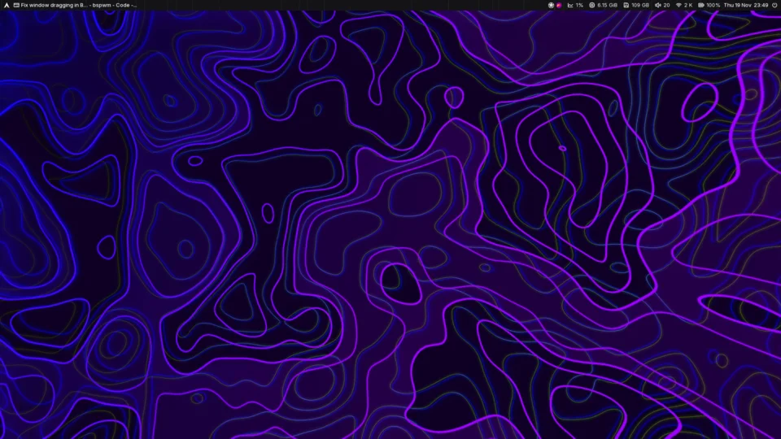

# dotfiles

My Arch Linux desktop: **bspwm** with 19 switchable themes ("rices"), polybar/eww bars,
rofi menus and a macOS-style `cupertino` theme as the daily driver.



## Install on a fresh Arch Linux

You need a working Arch install with a normal user that can use `sudo`, and an internet
connection. Nothing else: no desktop, no display manager.

```sh
sudo pacman -S --needed git
git clone https://github.com/anakin-dabir/dotfiles.git ~/dotfiles
~/dotfiles/install.sh
```

Then reboot, log in through **ly** and pick **bspwm**.

### What `install.sh` does

1. Adds the **chaotic-aur** repository (prebuilt AUR packages) and updates the system.
2. Installs every package in [`packages/repo.txt`](packages/repo.txt) and
   [`packages/aur.txt`](packages/aur.txt).
3. Asks whether this is the **HP Victus / NVIDIA laptop**. If yes, it also installs
   [`packages/hardware-*.txt`](packages) and the fixes in `misc/system/hp-victus/`
   (keyboard RGB, NVIDIA power management, suspend/wake fixes).
4. **Links** every folder in `config/` into `~/.config/`, and `home/.zshrc`, `home/.gtkrc-2.0`
   into `~`. Anything already there is moved to `~/.config-backup-<date>/`, never deleted.
5. Links the GTK themes and icons into `~/.local/share/`, installs the fonts and helper scripts.
6. Installs small system tweaks from `misc/system/common/` (pacman update hook, journal size
   cap, iPhone auto-mount rule).
7. Enables services (mpd, update checker, battery warnings, NetworkManager, Bluetooth, ly)
   and makes zsh the default shell.

It's safe to run again; it skips what's already done.

## Repository layout

```
config/          → linked to ~/.config/<name>
  bspwm/           window manager, bars, rices, scripts (the heart of it)
  dunst/ jgmenu/ kitty/ alacritty/ st/ geany/ yazi/ mpd/ ncmpcpp/ ...
  systemd/         user services: update checker, battery warning
home/            → linked to ~/ (.zshrc, .gtkrc-2.0)
misc/
  themes/ icons/   GTK, icon and cursor themes
  fonts/           fonts the bars and menus use
  bin/             small helper scripts (→ ~/.local/bin)
  system/          files installed under / (common + hp-victus)
  LICENSES.md      licenses of the bundled themes, icons and fonts
packages/        package lists the installer reads
install.sh       the installer
```

### Inside `config/bspwm`

```
bspwmrc            startup: monitors, rules, daemons, then applies the current rice
config/sxhkdrc     all keybindings
config/modules/    scripts that recolor apps when you switch rice (rofi, dunst, kitty, gtk, …)
rices/<name>/      one folder per theme: colors and settings in theme-config.bash
bars/<name>/       polybar/eww bars; any rice can use any bar
bin/               scripts behind the keybindings and bar buttons
```

## Everyday use

Because the configs are **links into this repo**, editing `~/.config/bspwm/...` edits the
repo directly. To save your changes:

```sh
cd ~/dotfiles
git add -A && git commit -m "describe the change" && git push
```

Switching themes rewrites a few generated color files (`bars/colors.ini`,
`config/rofi-themes/shared.rasi`, `dunst/dunstrc.d/theme.conf`, …), so those show up as
changes too. Commit them or ignore them; they're regenerated every time.

### Useful keys

| Keys | Action |
|---|---|
| `alt + F1` | Keybinding cheatsheet |
| `super + q` / `super + alt + q` | Terminal / floating terminal |
| `super + space` | App launcher |
| `alt + space` | Switch theme (rice) |
| `super + alt + space` | Switch bar for the current theme |
| `super + w` / `e` / `r` | Browser / VS Code / file manager |
| `super + alt + w` | Wallpaper picker |
| `super + alt + n` / `b` / `c` | Wi-Fi / Bluetooth / clipboard menus |
| `super + alt + i` | Notification center panel (or click the bell on any bar; right-click it for Do Not Disturb). Click a notification to jump to its app |
| click a menubar item (cupertino) | Dropdown for it: CPU, memory, storage, sound, network, battery, calendar |
| `Print` / `shift + Print` | Screenshot menu / Flameshot |
| `super + alt + p` | Power menu |
| `super + alt + j` / `g` | Keyboard backlight color / rainbow |
| `super + {1-9,0}` | Go to desktop |
| `super + a` | Close window |
| `super + alt + r` | Reload bspwm |
| `super + Escape` | Reload keybindings |

All bindings are in [`config/bspwm/config/sxhkdrc`](config/bspwm/config/sxhkdrc).

## Customizing

- **Colors, fonts, padding, wallpaper for a theme:** `config/bspwm/rices/<name>/theme-config.bash`,
  then re-apply it with `alt + space`.
- **New theme:** copy a folder in `rices/`, change its colors and `main_bar`, add a `preview.webp`.
- **Stop recoloring an app:** rename its script in `config/bspwm/config/modules/` from `.sh` to
  `.disabled`.
- **Add a package to future installs:** add its name to `packages/repo.txt` (official repos and
  chaotic-aur) or `packages/aur.txt`.

## Secrets

Never put tokens or passwords in `home/.zshrc`; this repo is public. Put them in
`~/.zshrc.local`, which `.zshrc` loads and which is not in the repo:

```sh
echo 'export SOME_TOKEN=...' >> ~/.zshrc.local
```

## HP Victus notes

The installer can't edit kernel parameters for you. For the laptop's black-screen-after-sleep
fix, add `i915.enable_psr=0 i915.enable_dc=0 i915.enable_fbc=0` to
`GRUB_CMDLINE_LINUX_DEFAULT` in `/etc/default/grub`, then run
`sudo grub-mkconfig -o /boot/grub/grub.cfg`.

## License

GPL-3.0, see [`LICENSE`](LICENSE). Some files keep the copyright notice of the GPL-3.0
project this setup grew from. Bundled themes, icons and fonts are listed with their licenses
in [`misc/LICENSES.md`](misc/LICENSES.md).
